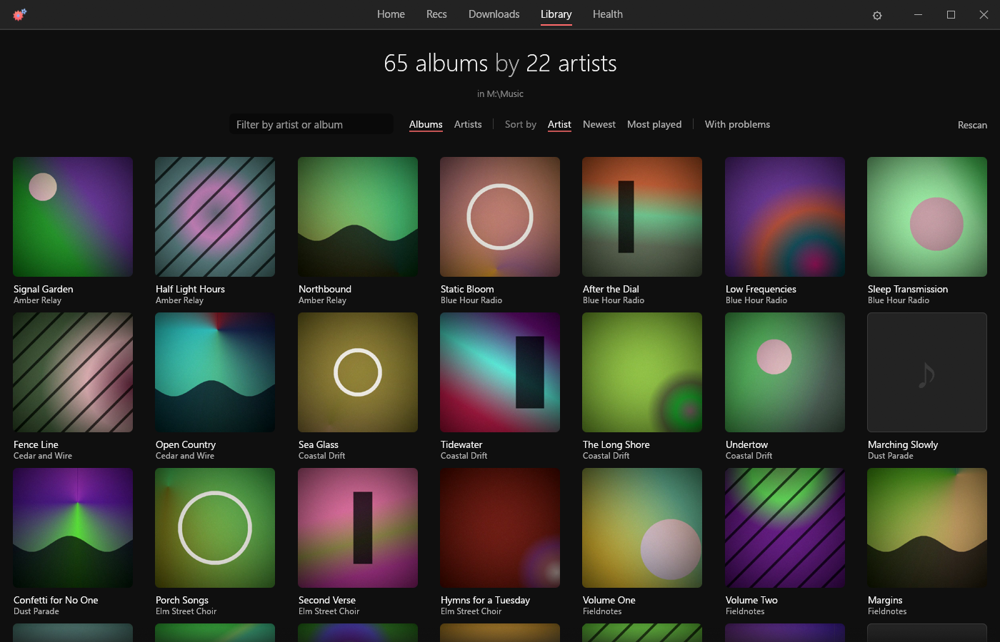
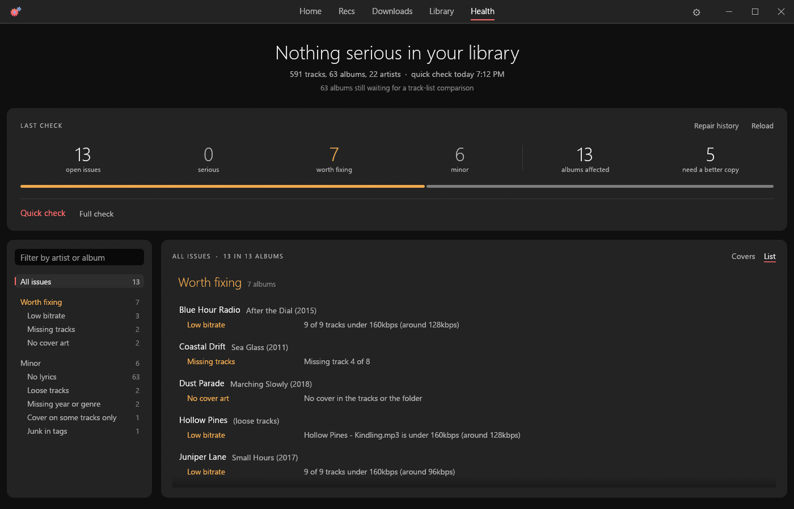

# Bradley's Music Tool

A Windows app that looks after a music library kept in folders: it shows what you have, finds what is wrong with it and repairs it, tells you what your artists have released, and files new albums in the right place.



It is for people who keep their own music files, sorted as `Artist\Album (Year)\songs`. It is not a player. For that there is [Cadence](https://github.com/BradChadley/Cadence-Releases), by the same author.

## What it does

**Library.** Every album and artist in your music folder, as covers. Filter by name, sort by artist, newest or most played, and open an album to see its songs.

**Health.** Checks the whole library and lists what it finds, most serious first: MP3s that were blown up from a worse file, songs that stop early, missing tracks, low bitrates, missing or small covers, junk in tags, missing years, missing lyrics, songs lying loose outside an album. Most of it can be repaired with a click. Nothing is deleted for good: what a repair replaces goes to an undo folder or the Recycle Bin, and a repair can be taken back from the repair history.



**Recs.** With a free Last.fm account it compares what you play with what you own and shows three lists: new releases from artists you like, artists to try, and all of your artists ranked. Click an artist for their albums, best first, with the ones you already have marked. In Settings, choose **Connect Last.fm**, approve access in your browser, and return to the app. You do not need an API key or to give the app your password.

**Downloads.** Files a finished download into the library: reads the tags, fixes names and covers, converts if you want it to, and warns before it replaces a better copy with a worse one. It can also drive [slskd](https://github.com/slskd/slskd), a client for the Soulseek network, to search for an album and fetch it. That part is optional, needs a Soulseek account of your own, and what you download with it is your responsibility.

**Home.** One page that says where things stand: what is new from your artists, what is on its way, the state of the library and of the last check.

**Backup.** Keeps checked copies of your library on a main drive and an optional second drive. Replaced and removed files are kept for 30 days. Existing backup settings still work, and the Backup page can set up nightly runs of the app.

## Get it

Download the newest zip from the [Releases page](https://github.com/BradChadley/bradleys-music-tool/releases/latest), unpack it into a folder of its own, and start `bradleys-music-tool.exe`. There is no installer. The app asks where your music is and is ready.

**Windows will warn you the first time.** The app is not signed, so Windows shows "Windows protected your PC". Click **More info**, then **Run anyway**.

It needs Windows 10 or 11, 64-bit. Everything else it fetches for itself when you ask it to, from the makers' own release pages, and checks each download against a known checksum:

| What | What for | Size |
|---|---|---|
| [FFmpeg](https://ffmpeg.org) | Checking and converting music files | 115 MB |
| [slskd](https://github.com/slskd/slskd) | Only if you set up Soulseek | 56 MB |

## What it does on your PC, and what it sends

- Your settings and its saved lookups are in `%LOCALAPPDATA%\music-recs`. Delete that folder and the app is as new.
- Your Last.fm session and Soulseek login are kept in Windows Credential Manager. Last.fm's password is entered only on Last.fm's website. Existing username/API-key setups continue to work; Disconnect removes the saved connection on this PC. You can also revoke the app's access in your Last.fm settings.
- It changes files in your music folder only when you click a repair or an import. If your library is laid out another way, choose "Look only, change nothing" at the first start and it will only report.
- Nothing is sent to the author. The app goes online to look up music (Last.fm, MusicBrainz, the Cover Art Archive, Apple's music search, Deezer, Bandcamp, LRCLIB for lyrics) and to fetch the helpers above. Those services see the artist and album names it asks about.
- It keeps itself up to date: twice a day it reads one small file from this repository's releases, and when there is a newer version it fetches it, checks that it carries the author's signature, and puts it in the next time you restart. It never restarts by itself. Settings, About has the choice to be told only, or to never check.
- The Soulseek client it sets up shares none of your files and can only be reached from your own PC.

## Build it yourself

You need a recent [Rust](https://rustup.rs) (it is built with 1.96) and the Visual Studio C++ build tools.

```
cargo build --release
cargo test --release
```

The program file is `target\release\bradleys-music-tool.exe`. A test run that keeps away from your real settings: set the environment variable `MUSIC_RECS_DATA` to an empty folder before starting it.

For browser sign-in, set `BMT_LASTFM_API_KEY` and `BMT_LASTFM_SHARED_SECRET` in the build environment to the credentials of your registered Last.fm application. Cargo embeds them in the desktop executable; end users do not configure them. Keep the values out of source control and build logs. Like other desktop clients, an executable cannot make an embedded application secret unrecoverable. Builds without these values keep existing Last.fm connections but cannot start a new browser sign-in. The release script requires both values.

The source is one Rust program (`src`, drawn with [egui](https://github.com/emilk/egui)), including the tag editor and backup worker. The folder and the data folder are named `music-recs` because the app began as the Recs page alone.

## Problems and ideas

Report them on the [Issues page](https://github.com/BradChadley/bradleys-music-tool/issues). Say what you did, what you expected and what happened; a picture helps. This is one person's spare-time project, so answers can take a while.

## Support

The app is free. If it saved you an evening of retagging, you can [buy me a coffee on Ko-fi](https://ko-fi.com/bradchadley).

## Also by Bradley

[Cadence](https://github.com/BradChadley/Cadence-Releases), a music player for Windows.

## License

Bradley's Music Tool is free software under the [GNU General Public License, version 3](LICENSE). It comes with no warranty. The libraries it is built from and the tools it fetches are listed, with their licenses, in [THIRD-PARTY-NOTICES.txt](THIRD-PARTY-NOTICES.txt).
